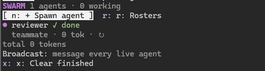
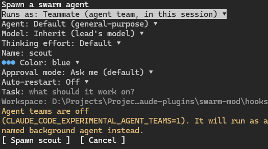

# Swarm (powermods-swarm)

A Claude Code mod for running a swarm of agents from a side pane. You spawn agents, watch their live state and token use, answer their approvals and questions, and message them, all from the session you started in.

> **Claude Code only.** Runs in the Claude Code CLI (v2.1.287+), the Desktop app's Code tab (v2.1.286+) and the VS Code extension (v2.1.299+ for panes). It does nothing in claude.ai chat or Cowork.

| Swarm pane | Spawn form |
|---|---|
|  |  |

Supports **Windows** and **macOS** (Linux best effort). Its tests run on Claude Code **v2.1.331**, on Windows 11 (PowerShell 7 and Windows Terminal). The macOS paths are covered by unit tests, and the generated launch script was checked with a POSIX shell, but they haven't been run on a Mac yet.

Before you install it, read [Data, network and permissions](#data-network-and-permissions) and [How approvals work](#how-approvals-work). The privacy statement is in [PRIVACY.md](PRIVACY.md).

## Install

This repo is a Claude Code plugin marketplace. Inside Claude Code:

```text
/plugin marketplace add netgfx/claude-swarm-mod
/plugin install powermods-swarm@claude-swarm-mod
```

Or in one step (Claude Code v2.1.275 or later):

```text
/plugin install powermods-swarm --marketplace netgfx/claude-swarm-mod
```

Or from a shell:

```shell
claude plugin marketplace add netgfx/claude-swarm-mod
claude plugin install powermods-swarm@claude-swarm-mod
```

Restart Claude Code (or run `/reload-plugins`), then type `/swarm`. To get updates later, run `claude plugin marketplace update claude-swarm-mod`.

For teammates that join this session's agent team, also set `CLAUDE_CODE_EXPERIMENTAL_AGENT_TEAMS=1` (see [Transports](#transports)). To run it from a local checkout instead, see [Load it from a checkout](#load-it-from-a-checkout).

### Upgrading from swarm-mod

Up to 0.4.0 the plugin was named `swarm-mod`. The marketplace maps the old name to the new one, so Claude Code moves an existing install and its settings over. Because the marketplace comes from GitHub, run `/plugin install powermods-swarm@claude-swarm-mod` once after updating. On its first start, the renamed plugin copies your saved rosters, each workspace's last swarm and the band setting from the old `swarm-mod` store, without replacing anything already there (see [Data, network and permissions](#data-network-and-permissions)).

Other mods that read the pane's state now find it under `powermods-swarm.snapshot` (it was `swarm-mod.snapshot`), and Claude sees the status tool as `mcp__powermods-swarm__swarm_status` (it was `mcp__swarm-mod__swarm_status`).

## Settings

Both options are off until you turn them on with `/plugin configure powermods-swarm@claude-swarm-mod` (or the gear on the plugin in VS Code). Reload plugins after changing them.

| Option | Default | What it does |
|---|---|---|
| `allowBypass` | off | Offers **Bypass all checks** as an approval mode in the spawn form. A separate session then starts with `claude --dangerously-skip-permissions`, and a teammate has every call approved that Claude Code would ask you about. Each use asks you to confirm, naming the folder: a second press of **Spawn** (or **Save**) in the form, or a dialog when a saved roster or last swarm asks for it. With the option off, the mode isn't offered, and an agent saved with it runs as **Ask me**. Deny rules still apply either way. |
| `workersAcceptMessages` | off | Starts each separate-session worker with `crossSessionInbound` set to `accept`, for that worker only, through `--settings`. With it off, workers keep Claude Code's own handling of messages from other sessions, or your `crossSessionInbound` setting, so a worker may hold a message from the lead until you approve it in its window. |

## What it does

| Feature | How |
|---|---|
| **Spawn Agent** button | The `n: + Spawn agent` button in the swarm pane, `+ Spawn agent` in the band above the prompt, or `/swarm spawn`. |
| Spawn form | Transport (teammate or separate session), agent type (built-ins plus `~/.claude/agents` and `.claude/agents` files, plus any type Claude Code offers, including plugin agents), model, thinking effort, instance name (unique, suggested for you), color (suggested at random from a 12-color palette, never one a live agent already has), approval mode, and an optional first task. |
| Same workspace | Every agent starts in the lead session's working directory. Teammates share the lead's process. Separate sessions `Set-Location` / `cd` there before `claude` starts. |
| Live state | `starting`, `working` (with the current tool, such as `Bash: npm test`), `waiting`, `idle`, `done`, `failed`, `stopped`, `exited`, `no heartbeat`, plus **! needs approval** and **? has a question**. |
| Token use | Per agent: total, input, output, cache read, cache write, current context size, and turn count. Plus a swarm total. |
| Agent view | Click a name to open its panel. On a wide fullscreen terminal it's a docked side panel; otherwise it opens inline in the main area. `e` expands it (with the teammate's conversation), `c` / Esc closes it and restores the normal layout. A separate session also has `w: Open its window`, which brings its exact tab forward: by tty in Terminal.app or iTerm2 on macOS, by window title on Windows. |
| Spawn errors | A failed agent's row shows a short `failed · copy error` button. Pressing it copies the whole error to the clipboard (or press `o` in its panel), so a long `InputValidationError` isn't cut off. |
| Needs-you icon | A red `! review` / magenta `? answer` button on the agent's row and in the band, plus a toast. Its panel has **Approve / Deny / Use its own prompt**, or the question's options plus a free-text "Other". |
| Messaging | Message one agent from its panel, or broadcast to every live agent. This uses cross-session messaging (`$.session.send`): `{ agentId }` for teammates, `{ sessionId }` for separate sessions. |
| Kill / interrupt | Per agent, `k: Kill`. Teammates are stopped with `TaskStop`. A separate session's process is ended by its PID (`taskkill /T /F` on Windows, `kill -TERM` on macOS), after checking that the PID still belongs to `claude`, so a reused PID is never killed. If that check fails, the session ends itself. `i: Interrupt` stops only the current turn. |
| **Kill all** | `k: Kill all` in the swarm pane (press twice within 6 s to confirm), or `/swarm kill-all`. Pending approvals are denied so nothing waits on a dead agent, and killed agents are never auto-restarted. |
| **Auto-restart** | Off by default. Turn it on in the spawn form or with `a` in an agent's panel. A teammate that **failed**, or a separate session that **crashed**, **exited unexpectedly**, or **hung** (no heartbeat for a full minute of the main session's own time, so waking from sleep doesn't count), comes back with the same name, color, model, effort, approval mode and task. The task is prefixed with a note to check the workspace first. The backoff is 5 s, 15 s and 45 s, for up to 3 restarts. A hung session is killed first. Kill, `/exit`, and the agent panel's stop are treated as deliberate and never undone. `p: Respawn` brings back any stopped agent by hand. |
| **Saved rosters** | `r: Rosters` (or `/swarm rosters`) saves the current swarm under a name: each agent's name, color, type, model, effort, approval mode, transport, task and auto-restart. Launch a roster in any workspace with one click (or `/swarm load <name>`). Names and colors already in use are adjusted (`scout` → `scout-2`). Rosters live in the mod store, shared by every session on this machine. |
| **Every subagent, whoever spawned it** | Subagents and teammates spawned outside the swarm (Claude's own Agent calls, another plugin's spawns, ones started before the mod loaded) join the swarm too, named after their description (`Game UI / HUD / cards` → `game-ui-hud-cards`). You see their status, current tool and tokens, can message, kill or remove them, and **Edit** them (`m` in their panel) to rename, recolor, or change type, model, effort, approval mode, task and auto-restart, then save them in a roster. They keep Claude Code's own permission prompt and questions. They stay out of the automatic last swarm until you save a roster. A removed one is not added back. |
| **Restore last swarm** | Each workspace's latest swarm is saved automatically. When you start Claude Code there again, the band and the pane offer **Restore last swarm (N)** (or `/swarm restore`). |

### Transports

**Teammate (agent team).** The mod calls `$.agent.spawn({ name, subagentType, model, prompt })`. `$.agent.spawn` only accepts a model family alias (`opus`, `sonnet`, `haiku`, `fable`), so the model picked in the form (stored as a full id such as `claude-sonnet-5-5`) is mapped to its alias first; Inherit sends no model. The agent's loop runs inside the lead's process, so the mod sees its model steps (tokens, plus the per-agent **effort**, applied by rewriting `turn.step`), its tool calls (activity, edited files), and its permission checks (the **approval mode**, applied in `tool.check`).

With `CLAUDE_CODE_EXPERIMENTAL_AGENT_TEAMS=1` set, the agent joins this session's agent team. That variable turns on an experimental Claude Code feature, so teammate behavior can change between Claude Code releases. **Without it**, the agent runs as a named background subagent of the lead instead, and the spawn form says so: it isn't a member of an agent team, but the pane still shows its status, tokens and activity, applies its approval mode and effort, holds its approvals and questions, messages it by agent id, and stops it with `TaskStop`. Separate sessions don't depend on the variable.

**Separate Claude Code session.** The mod writes `~/.claude/swarm-mod/launch/<id>.ps1` (Windows), `.command` (macOS), or `.sh` (Linux), then opens a terminal:

- Windows: a tab in a Windows Terminal window named `swarm` (`wt.exe -w swarm new-tab --title "swarm: <name>" -d <workspace> powershell -NoProfile -ExecutionPolicy Bypass -NoExit -File <id>.ps1`), or a plain console window (`cmd /d /c start "swarm: <name> " /D <workspace> powershell …` with the same arguments) if Windows Terminal is missing. `-ExecutionPolicy Bypass` applies to that one PowerShell process, so the generated script can run where scripts are otherwise restricted; it doesn't change your machine's execution policy.
- macOS: a new iTerm2 window when the lead runs in iTerm2 (`TERM_PROGRAM=iTerm.app`, through `osascript`), otherwise a new Terminal.app window (`open -a Terminal <id>.command`, which needs no permissions). The `.command` script records its own `tty` and runs `claude` through your login shell (`$SHELL -lic`; fish falls back to zsh/bash), so `claude` and `node` resolve from the PATH your shell normally has, even when the lead runs in the Desktop app.
- Linux: `x-terminal-emulator`, `gnome-terminal`, `konsole`, or `xterm`, each running `/bin/sh <id>.sh`.

The script sets the worker's identity in environment variables (`SWARM_MOD_WORKER`, `SWARM_MOD_LEAD`, `SWARM_MOD_NAME`, `SWARM_MOD_APPROVAL`, `SWARM_MOD_TASK`), changes to the workspace, sets the window title, and runs:

```text
claude --name <name> --plugin-dir <this mod> [--agent <type>] [--model <m>] [--effort <e>]
       [--permission-mode <mode> | --dangerously-skip-permissions] [--settings <worker-settings.json>]
```

`--model` gets the full model id, which the CLI accepts. `--dangerously-skip-permissions` is only there when you turned on `allowBypass`, picked **Bypass all checks** and confirmed it. `--settings` is only there when you turned on `workersAcceptMessages`: then `worker-settings.json` holds `{ "crossSessionInbound": "accept" }`. The first task is passed in `SWARM_MOD_TASK` and the worker submits it itself. Neither the task nor the JSON goes on the command line, because Windows PowerShell 5.1 mangles quotes inside native arguments.

In that session the same mod runs in **worker mode**. It reports status, activity, tokens, edited files, its last answer, and any pending approval or question to `$.store` (shared by all sessions on the machine). The lead checks for updates every 1.5 s and marks a worker `no heartbeat` after 20 s of silence.

### Messages to separate sessions

The lead sends your messages and broadcasts to a worker with `$.session.send({ to: { sessionId } })`, Claude Code's cross-session messaging. The worker decides whether to deliver each one by its own [inbound-message rules](https://code.claude.com/docs/en/cross-session-messaging#control-inbound-messages):

- **With `workersAcceptMessages` off (the default)**, the worker keeps Claude Code's default, or your own `crossSessionInbound` setting. By default a worker that prompts for permissions (Ask me, Accept edits, Auto, Plan, Don't ask) delivers the lead's messages, and a worker started with **Bypass all checks** holds each one for your approval in its window, as Claude Code does for any session that bypasses permission prompts. If your settings say `hold`, every message waits for your approval there; `refuse` drops them. When a message can't be delivered, the toast says why and points at this setting.
- **With `workersAcceptMessages` on**, each worker starts with `crossSessionInbound: "accept"` for itself only, so the lead's messages arrive without asking. A `refuse` in the project's own settings still wins, as Claude Code's precedence rules say.

The worker's first task never travels as a message (the worker submits it itself), and approvals and questions travel through `$.store`, so a held message never blocks them.

## How approvals work

The mod has a `tool.check` hook. For a tool call from a swarm agent, it first asks Claude Code for its own decision (your permission rules, the permission mode, and `PreToolUse` hooks), then applies the agent's approval mode to that decision:

| Approval mode | What the swarm changes, for a teammate | Separate session |
|---|---|---|
| Ask me (default) | Nothing. A call Claude Code would ask about waits in the swarm pane. | `--permission-mode default` |
| Accept edits | Edit, Write, NotebookEdit and MultiEdit are **allowed where Claude Code would ask**. Everything else as Ask me. | `acceptEdits` |
| Auto | Nothing: follows the lead session's own mode, and nothing is held in the pane. | `auto` |
| Plan / read-only | Edits are **denied**, even where Claude Code would allow them, and so is anything Claude Code would ask about, with a reason Claude can act on. Calls Claude Code allows, such as reads, go ahead. | `plan` |
| Don't ask | Anything Claude Code would ask about is **denied**. | `dontAsk` |
| Bypass all checks (only with `allowBypass`, confirmed per agent) | Everything Claude Code would ask about is **allowed**. | `--dangerously-skip-permissions` |

- **It never overrides a deny.** A call Claude Code denies (a deny rule, a hook that blocks it, a refused permission mode) stays denied in every mode. The swarm only ever turns an "ask" into "allow" or "deny", or an "allow" into "deny" (plan mode). Where Claude Code's built-in guard runs (managed settings, or a Team or Enterprise login), a call that an `ask` rule or a `PreToolUse` hook would stop also still prompts or stays blocked after the swarm approves it.
- **Holds.** When the decision is still "ask", the call waits in the swarm pane, with a toast and a red `! review` in the band: **Approve** allows it, **Deny** denies it (Claude reads "The user denied this in the swarm pane. Do not retry it; ask how to proceed."), and **Use its own prompt** hands it back to Claude Code's own permission prompt. A teammate's request waits up to **15 minutes**, then goes to Claude Code's normal prompt in the lead. A separate session's request waits up to **3 minutes** for your answer from the lead's pane (through `$.store`), then goes to the worker's own prompt in its window. Workers in Auto, Don't ask or Bypass mode hold nothing.
- **Questions.** An `AskUserQuestion` call from a swarm teammate, or from a worker's main conversation, waits in the pane the same way: your answers are returned as the tool's result, or **Use its own prompt** shows Claude Code's own question.
- **Who it applies to.** Only calls from agents in the swarm, matched through `tool_use_id`. The lead's own conversation is never changed. Subagents that joined the swarm on their own (spawned by Claude or another plugin) keep Claude Code's own prompt and questions until you **Edit** them and pick an approval mode.
- **If the hook fails.** A hook that throws or times out is skipped and Claude Code decides as if the mod weren't there, except for a call from an agent in Plan or Don't ask mode, which is denied, because you chose that restriction.

Claude Code can't set a teammate's permission mode at spawn time, which is why the mod applies the mode itself at `tool.check`.

## Data, network and permissions

In short, for reviewers (each point is detailed further down):

- **Programs it runs:** with `$.process.run`, no shell, as you: a terminal to open each separate-session worker (`wt.exe` or `cmd /d /c start` with `powershell -NoProfile -ExecutionPolicy Bypass -NoExit -File <launch script>` on Windows; `open -a Terminal <script>` or `osascript` for iTerm2 on macOS; `x-terminal-emulator`, `gnome-terminal`, `konsole` or `xterm` running `/bin/sh <script>` on Linux), `chmod +x <script>` before that on macOS and Linux, `powershell` (`WScript.Shell` `AppActivate`), `osascript` or `wmctrl` to bring a worker's window forward when you press **Open its window**, `powershell` (`Get-CimInstance`/`Get-Process`) or `/bin/sh -c 'echo "$PPID $(ps -o comm= -p $PPID)"'` for a worker to learn its own process id, `Get-Process -Id <pid>` or `ps -o comm= -p <pid>` and then `taskkill /PID <pid> /T /F` or `kill -TERM <pid>` to end a worker you kill, `uname -s` once to tell macOS from Linux, and `ping -n 2 127.0.0.1` or `sleep 1` as a one-second wait while a request is held. The commands that name a path, a window title or a process id are built from the launch script's path under `~/.claude/swarm-mod/launch/`, the agent's name and the worker's pid; nothing else goes into a command, and nothing it runs downloads anything.
- **What it sends and where:** nothing leaves this computer. It makes no network requests and no model calls of its own. What the mod reads stays on this machine: an agent's name, workspace path, model, effort, approval mode and first task go into that worker's launch script, command line and environment; a worker's report (status, the start of each prompt it received, short tool summaries, edited file paths and its last answer) goes into `$.store`, which every Claude Code session on this computer can read; the pane's state goes into `$.state`, which other mods can read; the messages you type go to the agent you address, through Claude Code's local cross-session messaging.
- **Conversation data it reads:** a worker reads the text of each prompt it receives (`turn.start`) and its own last answer (`turn.complete`) to report them to the lead; the lead reads swarm agents' tool calls to show their activity and, in an expanded teammate panel, that teammate's recent messages (`$.session.messages`), only to draw them. It can go only to the pane, `$.store` and `$.state` on this computer, never to a host.
- **What it puts in prompts it submits:** a separate-session worker submits exactly the first task you typed in the spawn form or saved in a roster, read from its `SWARM_MOD_TASK` variable. After an auto-restart, that task is prefixed with *"(You were restarted after your previous run ended unexpectedly. Check the current state of the workspace before continuing.)"*. It submits nothing else.
- **What it gives the agents it starts:** a teammate gets `$.agent.spawn` with your task as its prompt (or, with no task, *"You are "<name>", a member of the user's agent swarm, working in <workspace>. Introduce yourself in one line, then wait for instructions."*), its name, the description `swarm: <name>`, the agent type and model you picked. A separate session gets the command line `claude --name <name> --plugin-dir <this mod> [--agent <type>] [--model <m>] [--effort <e>] [--permission-mode <mode> | --dangerously-skip-permissions] [--settings <worker-settings.json>]`, the variables `SWARM_MOD_WORKER`, `SWARM_MOD_LEAD`, `SWARM_MOD_NAME`, `SWARM_MOD_APPROVAL` and `SWARM_MOD_TASK`, and the lead's working directory. Later, only the messages you type.
- **Files it writes:** `~/.claude/swarm-mod/launch/<id>.ps1`, `.command` or `.sh` (each one a start-up script: it starts that worker's `claude`), `~/.claude/swarm-mod/launch/<id>.tty` (macOS and Linux, the worker's terminal device), and `~/.claude/swarm-mod/launch/worker-settings.json`, a Claude Code settings file passed to workers with `--settings`, written only when you turn on `workersAcceptMessages` and holding only `{ "crossSessionInbound": "accept" }`. It writes no build file, no instructions file such as `CLAUDE.md`, no `.gitignore`, and nothing in your project.
- **Permission decisions:** a `tool.check` hook decides only for tool calls of agents in the swarm, never for the lead's own conversation. It first takes Claude Code's own decision, then applies the approval mode you picked for that agent: Accept edits allows edits Claude Code would ask about; Plan denies edits and anything Claude Code would ask about; Don't ask denies anything Claude Code would ask about; Bypass all checks (only with `allowBypass` on and your confirmation) allows what Claude Code would ask about. A call still waiting for an answer is held in the swarm pane until you press Approve, Deny or Use its own prompt (up to 15 minutes for a teammate, 3 for a worker), then goes back to Claude Code's own prompt. It never turns a deny into an allow. A separate-session worker starts in the permission mode you picked in the form, **Ask me** (`--permission-mode default`) unless you pick another. See [How approvals work](#how-approvals-work).
- **Tools it calls itself:** `TaskStop`, through `$.tool.call`, to stop a teammate when you press **Kill**, **Interrupt** or **Kill all**; and Claude Code's question dialog (`AskUserQuestion`, through `$.ui.ask`) to ask you before a saved roster starts agents with **Bypass all checks**. It also starts the agents you ask for with `$.agent.spawn`.
- **Tool results it answers, and tool input it changes:** a `tool.call` hook answers two tools itself: its own `mcp__powermods-swarm__swarm_status` (the roster as text), and `AskUserQuestion` from a swarm agent when you answer that question in the swarm pane (your answers become the result; with **Use its own prompt**, Claude Code asks instead). It never changes any tool's input.
- **Slash commands it runs:** none. It registers `/swarm` and `/swarm-spawn`, and runs no command on your behalf.
- **Environment variables / config it sets:** it calls no `$.env.set` and changes nothing in your settings. The `SWARM_MOD_*` variables are set only inside each worker's launch script, for that worker's own process. The only Claude Code setting it can give a worker is `crossSessionInbound: "accept"`, in `worker-settings.json`, with `workersAcceptMessages` on.
- **Hosts it contacts:** none.
- **Hooks:**
  - `session.start`: sets up the pane, the commands, the status tool and a 1.5-second timer; in the lead, copies old rosters once and deletes week-old worker reports from its own store; in a worker, reports to the lead and submits the first task. Changes nothing in the session.
  - `classic.SessionStart` (after `/clear`, `/resume` or `/branch`): writes the swarm back into `$.state`. Changes nothing.
  - `session.end`: a worker reports that it exited. Changes nothing.
  - `command.run` for `/swarm` and `/swarm-spawn`: answers its own commands.
  - `agent.spawn`: adds subagents someone else spawned to the swarm. Never refuses or changes a spawn.
  - `agent.offer`: records the agent types Claude Code offers, for the spawn form. Changes nothing.
  - `tool.call`: records swarm agents' activity and edited files, and answers `swarm_status` and swarm agents' `AskUserQuestion` as above. Never changes a call's input.
  - `tool.check`: the permission decisions above.
  - `turn.step`: sets the thinking effort of a swarm teammate's model requests to the one you picked, and counts tokens. Changes nothing else.
  - `turn.start`, `turn.complete`: count turns and keep each agent's last answer; a worker reports them. Change nothing.
  - `ui.focus` (spawn form), `ui.render` (its panes and the band above the prompt): draw the mod's own interface.

**Hosts reached.** None. The mod makes no network requests (`network.hosts` is empty). Agents and workers are ordinary Claude Code sessions on your plan: their model requests go to Anthropic (or your provider) like any session's. Cross-session messages between sessions on this machine use Claude Code's local socket or named pipe.

**Model use.** The mod makes no model calls of its own. Each agent you spawn runs its own model turns, billed to your plan or API key like any Claude Code session or subagent, and counted in the pane's token figures.

**Files written.**

- `~/.claude/swarm-mod/launch/<id>.ps1`, `.command` or `.sh`: the launch script for a separate session, made executable with `chmod +x` on macOS and Linux. It contains the agent's name, workspace path and first task. It isn't deleted automatically; delete the folder to remove the scripts.
- `~/.claude/swarm-mod/launch/<id>.tty` (macOS and Linux): written by the launch script, the worker's terminal device, used to bring its tab forward.
- `~/.claude/swarm-mod/launch/worker-settings.json`: only with `workersAcceptMessages` on, holding `{ "crossSessionInbound": "accept" }`.

**Files read.** Agent definitions in `~/.claude/agents/*.md` and `.claude/agents/*.md` (only their `name` and `description`, for the agent list), a worker's `.tty` file, and, once, after the rename: files named `swarm-mod_*.json` in Claude Code's plugin store folder (`~/.claude/plugins/store`, or `$CLAUDE_CONFIG_DIR/plugins/store`), to copy the old plugin's rosters. No other plugin's files are read. For an expanded teammate panel, the mod reads that teammate's recent messages with `$.session.messages({ agentId })` to show them; they aren't stored.

**Programs started** (with `$.process.run`, as you):

- Opening a worker: `wt.exe` or `cmd /d /c start` with `powershell -NoProfile -ExecutionPolicy Bypass -NoExit -File <script>` on Windows; `open -a Terminal <script>` or `osascript` (iTerm2) on macOS; `x-terminal-emulator`, `gnome-terminal`, `konsole` or `xterm` on Linux; `chmod +x <script>` first on macOS and Linux. The worker then runs `claude` with the arguments above, through your login shell on macOS and Linux.
- Bringing a worker's window forward: `powershell -NoProfile -NonInteractive -Command` with `WScript.Shell` `AppActivate("swarm: <name>")` on Windows; `osascript` telling Terminal or iTerm2 to select the tab with the worker's tty on macOS; `wmctrl -a "swarm: <name>"` on Linux.
- A worker reading its own process id: `powershell -NoProfile -NonInteractive -Command` with `Get-CimInstance Win32_Process` and `Get-Process` on Windows, `/bin/sh -c 'echo "$PPID $(ps -o comm= -p $PPID)"'` elsewhere.
- Ending a worker on **Kill**, **Kill all**, or a hung worker's auto-restart: first `Get-Process -Id <pid>` or `ps -o comm= -p <pid>`, and only if the process name is still the worker's (`claude`), `taskkill /PID <pid> /T /F` or `kill -TERM <pid>`. Otherwise the worker is asked through `$.store` to end itself, which it does with the same command on its own pid.
- `uname -s` once, to tell macOS from Linux; `ping -n 2 127.0.0.1` (Windows) or `sleep 1` as a one-second wait while a request is held.

**Prompts it submits and messages it sends.**

- A worker submits its first task (and, after an auto-restart, the task prefixed with *"(You were restarted after your previous run ended unexpectedly. Check the current state of the workspace before continuing.)"*) as a prompt with `$.prompt.submit`, so Claude sees it as coming from the mod.
- A teammate starts with your task as its prompt, or, with no task, *"You are "<name>", a member of the user's agent swarm, working in <workspace>. Introduce yourself in one line, then wait for instructions."*
- The lead sends only the messages and broadcasts you type, with `$.session.send` (see [Messages to separate sessions](#messages-to-separate-sessions)).
- **Interrupt** aborts a worker's current turn with `$.turn.abort`; **Kill** and **Interrupt** stop a teammate with the `TaskStop` tool through `$.tool.call`.

**Tool calls it observes, approves, denies or answers.** A `tool.call` hook reads every tool call to show swarm agents' activity and edited files, and to find which agent a permission check belongs to; it never changes a call's input. It answers `AskUserQuestion` for swarm agents when you answer in the pane. The `tool.check` hook approves, denies or holds swarm agents' calls as [How approvals work](#how-approvals-work) describes. A `turn.step` hook sets the thinking effort of a swarm teammate's model requests to the one you picked. An `agent.spawn` hook watches subagents start, to add them to the swarm; it never refuses or changes one. An `agent.offer` hook records the names of the agent types Claude Code offers, for the spawn form.

**What goes into `$.store`** (a store every Claude Code session on this machine shares):

- `w:<id>`: a worker's report: status, current tool summary (such as `Bash: npm test`), the last 40 log lines (each up to 160 characters, including the start of each prompt it received and short tool summaries), edited file paths, its last answer (up to 8,000 characters), token counts, session id and process id. Deleted when you remove the agent, clear finished agents, or respawn it, and otherwise once the worker has been silent for 7 days.
- `r:<id>`: the lead's replies to a worker: your recent approval decisions and answers, interrupt and kill requests. Deleted with its `w:<id>`.
- `roster:<name>`: a saved roster (each agent's name, color, type, model, effort, approval mode, transport, task and auto-restart). Kept until you delete it in the rosters pane.
- `last:<workspace>`: each workspace's last swarm, in the same form, without adopted subagents. Replaced as the swarm changes.
- `band`: whether the band above the prompt is on. `migrated:swarm-mod`: that the one-time copy from the old name ran.

**State other mods can read.** The pane's own state, `powermods-swarm.snapshot` in `$.state` (every agent's settings, status, recent log, edited files, last answer and token counts), lives in memory for the session and survives a reload of the mod. Any other mod can read it; the Session Dashboard mod does, to show the swarm.

**Settings and environment.** It reads the environment variables `OS`, `USERPROFILE`, `HOME`, `CLAUDE_CONFIG_DIR`, `TERM_PROGRAM`, `CLAUDE_CODE_EXPERIMENTAL_AGENT_TEAMS`, and in a worker `SWARM_MOD_WORKER`, `SWARM_MOD_LEAD`, `SWARM_MOD_NAME`, `SWARM_MOD_APPROVAL` and `SWARM_MOD_TASK`. It changes no environment variable of the session, reads no settings file, and adds nothing to Claude's system prompt. The only Claude Code setting it can give a worker is `crossSessionInbound: "accept"`, through `--settings`, and only with `workersAcceptMessages` on. The only permission flag it can give a worker is `--dangerously-skip-permissions`, and only with `allowBypass` on and your confirmation.

**Its own tool for Claude.** `mcp__powermods-swarm__swarm_status` returns the swarm's roster (name, transport, type, model, effort, approval mode, status, activity, tokens, what's waiting on you, last answers) so the lead Claude can coordinate. It reads nothing else.

## Commands, tool, and keys

- `/swarm`: open the swarm pane.
  - `/swarm spawn`: open the spawn form.
  - `/swarm status`: print the roster.
  - `/swarm rosters`: open the rosters pane.
  - `/swarm save <name>` and `/swarm load <name>`: save or launch a roster.
  - `/swarm restore`: bring back this workspace's last swarm.
  - `/swarm kill-all`: kill every agent.
  - `/swarm band off|on`: hide or show the band.
- `/swarm-spawn`: open the spawn form.
- Tool `mcp__powermods-swarm__swarm_status`: lets the lead Claude read the roster (status, activity, tokens, what's waiting on you, last answers) before it coordinates.
- Pane keys: `n` spawn, `r` rosters, `k` kill all (twice), `x` clear finished.
- Agent panel keys: `y` approve, `d` deny, `l` use its own prompt, `o` copy its error, `w` open its window, `i` interrupt, `k` kill, `p` respawn, `a` toggle auto-restart, `e` expand, `m` edit, `r` remove, `c` close.
- Rosters pane: type a name and press Enter to save; Launch or Delete each roster; `c` close.

## Load it from a checkout

PowerShell:

```powershell
claude plugin validate C:\path\to\swarm-mod
claude --plugin-dir C:\path\to\swarm-mod
# optional, for teammates:
$env:CLAUDE_CODE_EXPERIMENTAL_AGENT_TEAMS = '1'
```

Bash/Zsh:

```bash
claude plugin validate ~/mods/swarm-mod
CLAUDE_CODE_EXPERIMENTAL_AGENT_TEAMS=1 claude --plugin-dir ~/mods/swarm-mod
```

On macOS, the first time you use `w: Open its window` (or launch into iTerm2), macOS asks whether your terminal or the Claude app may control Terminal or iTerm. Allow it, or later in System Settings > Privacy & Security > Automation. Opening a Terminal.app worker doesn't need that permission.

For the Desktop app (Code tab), add the folder to `env.CLAUDE_CODE_PLUGIN_DIRS` in `~/.claude/settings.json` (paths separated by `;` on Windows, `:` on macOS), then start a new session. The sidebar docks in a fullscreen terminal at least 144 columns wide (110 once you've opened it yourself). Narrower than that, panes open inline above the prompt.

When the plugin is installed from the marketplace, separate-session workers get `--plugin-dir` pointing at the installed copy, so they run the same version as the lead.

## Tests

```shell
claude plugin test .
```

67 tests in three files. `tests/adopt.test.ts` covers subagents spawned outside the swarm: naming, adoption at spawn, from the agent list and from their first loop event, no double entry for the swarm's own spawns, keeping the native permission prompt, editing and saving one in a roster, kill and remove, and the edit form on both surfaces. `tests/lifecycle.test.ts` covers kill-all (the two-press confirm, TaskStop, kill by PID, the reused-PID guard, a worker ending itself), the auto-restart policy (failure, deliberate exits, hang detection, backoff, the restart limit), respawn and the auto-restart toggle, saving, launching and deleting rosters (with name and color fitting), a roster asking for Bypass all checks (off without `allowBypass`, a confirmation naming the folder with it), restoring the last swarm, copying rosters from the old `swarm-mod` store, pruning old worker reports, and the new panes on both surfaces. `tests/swarm.test.ts` covers color picking, name rules, mapping a picked model to the alias `$.agent.spawn` accepts, approval-mode decisions run through Claude Code's real order (tool call, permission check, tool), accept-edits, plan and bypass modes, a deny that is never turned into an approval, an approval held and then approved or denied from the pane, a question answered from the pane, Bypass all checks hidden without `allowBypass` and confirmed with it, `crossSessionInbound` set only with `workersAcceptMessages`, quoting of the worker CLI and launch script, path conflicts, the spawn form, per-agent effort and token counting, launches on Windows and macOS (Terminal.app and iTerm2, the login-shell script, the tty record, focus by tty with balanced AppleScript blocks, case-insensitive paths on APFS), worker reporting, lead pickup and messaging, every pane plus the band on both terminal and Desktop, and a refused spawn keeping its full error.

CI runs `claude plugin validate --profile directory --strict .` and `claude plugin test .` on Linux and Windows (`.github/workflows/validate.yml`).

## Releasing

`.claude-plugin/plugin.json` is the plugin manifest and `.claude-plugin/marketplace.json` makes this repo a one-plugin marketplace (`"source": "./"`, with `renames` mapping `swarm-mod` to `powermods-swarm`). `claude plugin validate .` checks both. When you release, bump `version` in both files so `claude plugin marketplace update` picks up the change.

## Extras built in

- **File-conflict radar**: when two agents edit the same file (case-insensitive on Windows and macOS, matching NTFS and APFS defaults), you get a `▲` line in the pane, a warning in each agent's panel, and a toast.
- **Broadcast** to every live agent.
- **Finished and failed** lines in each agent's log, with toasts on failures.
- **Status tool** so the lead Claude can coordinate the swarm with up-to-date information.

## Ideas for later

1. **Worktree isolation per agent**: an option to start a separate session in its own `git worktree` so edits never collide, with a merge view.
2. **Token and cost budgets**: a per-agent or swarm-wide cap that warns at 80% and interrupts at 100% (`turn.step` can refuse further steps).
3. **Task board**: show the team's shared task list with owners, color-coded by agent, plus drag-to-assign.
4. **File locks**: when the conflict radar fires, the second agent's edit waits for the lead's OK, not just a warning.
5. **Stuck-task nudges**: ping a teammate that sits on an in-progress task too long.
6. **Pause all**: interrupt every agent's turn without killing it, then resume.
7. **Auto-launch a roster** when a workspace opens (opt-in per roster).

## Changes

- **0.5.1**: For the directory's review: a summary at the top of [Data, network and permissions](#data-network-and-permissions) (programs, data, prompts, what agents get, files, permission decisions, tools, hooks); an invisible byte-order mark in a pattern is now written as `\uFEFF`; the one-second wait runs fixed commands.
- **0.5.0**: Renamed to `powermods-swarm` (display name **Swarm**); saved rosters are copied over from `swarm-mod`. **Bypass all checks** is now opt-in (`allowBypass`, off by default) and needs a confirmation naming the folder. Workers no longer get `crossSessionInbound: "accept"` unless you turn on `workersAcceptMessages`. Hooks fail open on errors (fail closed for Plan and Don't ask agents). Worker reports silent for a week are deleted. New README sections on approvals and data handling, a privacy statement, and CI on Linux and Windows.
- **0.4.0**: Every subagent or teammate spawned in the session joins the swarm, not just the ones spawned from the pane. An **Edit** form renames and retunes any agent, so ad-hoc subagents can be saved as a roster.
- **0.3.1**: Button labels drop the `x:` hotkey prefix (the hotkeys still work). The repo is now a plugin marketplace: install with `/plugin marketplace add netgfx/claude-swarm-mod`.
- **0.3.0**: First release: spawn, watch and steer a swarm of agents from a pane.

## License

MIT. See [LICENSE](LICENSE).
